# 🖥️ IT Asset Tracker

<p align="center">
  
</p>

<p align="center">
  A modern, self-hosted IT asset management system built for internal teams.
</p>

---

## ✨ What is this?

**IT Asset Tracker** helps you manage:

- Devices (laptops, desktops, equipment)
- Who has what assigned
- Locations and departments
- Asset status (In Use, Available, Retired)
- Labels with QR / Barcode
- Imports / exports

All running **locally with Docker** — no cloud dependency required.

---

## 🔥 Core Features

- 🧾 **Asset Management**
  - Assign assets to users
  - Track status, category, location
- 👤 **User Management**
  - View assigned assets per user
- ⚡ **Quick Check In / Check Out**
  - Fast modal workflow (no page switching)
- 🏷 **Label Printing**
  - QR codes + barcodes
- 📥 **CSV Import / Export**
- 🎨 **Clean UI + Dark Mode**
- 🔐 **Optional Microsoft Entra Login**
- 🐳 **Docker-first deployment**

---

## 📸 Screenshots

> Add screenshots here


---

## ⚡ Quick Start (2–3 minutes)

### 1. Clone the repo

  mkdir -p /opt/docker/apps
  cd /opt/docker/apps
  git clone <repo-url> It-Assets-Tracker

### 2. Copy the Docker compose

  mkdir -p /opt/docker/compose
  cp It-Assets-Tracker/docker/docker-compose.example.yml /opt/docker/compose/IT-Assets-Tracker.yml

### 3. Edit config (VERY IMPORTANT)

  Open:
    nano /opt/docker/compose/IT-Assets-Tracker.yml

  Change:
    APP_URL: http://YOUR-IP:4050
    SESSION_SECRET: change-me
    MARIADB_PASSWORD: change-me
    MARIADB_ROOT_PASSWORD: change-me-root

### 4. Start the app
  
  mkdir -p /opt/docker/data/it-assets-tracker/app
  mkdir -p /opt/docker/data/it-assets-tracker/mariadb

  docker compose -f /opt/docker/compose/IT-Assets-Tracker.yml up -d --build

### 5. Open the App

  http://YOUR-IP:4050
  Run the setup wizard → create your admin account → done ✅

### 🔄️ Updating

  cd /opt/docker/apps/It-Assets-Tracker
  git pull

  cd /opt/docker/compose
  docker compose -f IT-Assets-Tracker.yml up -d --build

### 💾 Backups (IMPORTANT)

  Backup this folder:
    /opt/docker/data/it-assets-tracker

### 🌐 Reverse Proxy (Optional)

  Works great with:
    Nginx Proxy Manager
    Traefik
    Cloudflare Tunnel

  Set:
    APP_URL=https://your-domain.com

```bash
